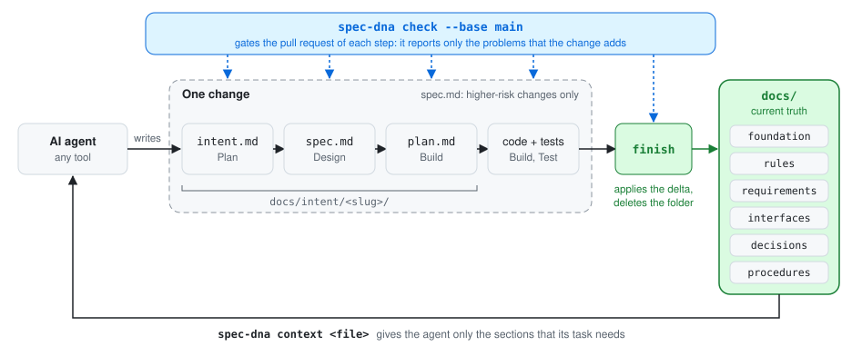

# spec-dna

[](https://github.com/AlexGavrilov939/spec-dna/actions/workflows/ci.yml)
[](https://github.com/AlexGavrilov939/spec-dna/releases)
[](LICENSE)

**Engineering specifications that stay small, linked and checked, for AI coding agents.**

spec-dna is a command-line tool for the specifications that a team keeps as Markdown files in its git repository. It checks each change of these documents, as a linter checks code. It gives a coding agent only the parts of the documents that its task needs. It works in any repository, with any language and with any agent that can run a shell command. It uses no network and no language model.

<picture>
  <source media="(prefers-color-scheme: dark)" srcset="docs/assets/how-it-works-dark.svg">
  
</picture>

## See it in action

One task, from the request to the merge. The agent runs spec-dna itself, because `init` wrote the steps into the instruction file of the agent.

```text
You:    When a moisture sensor times out, close the valve of its bed.

Agent:  $ spec-dna context src/valves.rs
        requirements/valves/closing#requirements   cites src/valves.rs
        rules/safety#rules                         applies to src/**
        The task adds a requirement, so I start a routine change.
        $ spec-dna new intent sensor-timeout
        wrote docs/intent/sensor-timeout/intent.md

You:    Accepted and merged.

Agent:  $ spec-dna new plan sensor-timeout
        wrote docs/intent/sensor-timeout/plan.md
        I approved the plan in its pull request.

You:    Merged.

Agent:  I wrote the code and the new requirement.
        $ spec-dna finish sensor-timeout
        error SD916: requirements/valves/closing#sensor-timeout has no evidence
        I added a test with "covers: requirements/valves/closing#sensor-timeout".
        $ spec-dna finish sensor-timeout
        evidence: 1 of 1 changed requirements; deleted docs/intent/sensor-timeout/
        $ spec-dna check --base origin/main
        0 new errors
```

When an agent edits an accepted decision, `check` stops the change:

```console
$ spec-dna check
docs/decisions/water-source.md:1: error SD405 decision-locked: the text outside the amendment and live sections changed after the decision was accepted
SD405 fix: Restore the accepted text and write the change in a new amendment section (`amendment-sections`, default `## Amendments`). Only a live section (`live-sections`, default `Status`) can change in place. As an alternative, write a decision that supersedes this one.
spec-dna check: 2 documents; 1 new error and 0 new warnings against 3bd199ae40b9 (1 error and 1 warning in total)
```

## Why

When AI agents write a large part of the code, the specifications are the main input of each task. Then these problems occur:

| Problem | What spec-dna does | Command |
| --- | --- | --- |
| An agent edits an accepted decision so that it agrees with its new code | Locks the text of an accepted decision. You write a new fact in an amendment or in a new decision | `check` (SD405) |
| A change renames a file or a function, and a spec still names the old one | Checks the links, ids, anchors and code citations of each change against its base | `check` |
| Documents grow, and an agent reads whole files to find one rule | Gives the sections that apply to a file, under a budget. Limits the size of documents and layers | `context`, `check` |
| Proposals and plans stay in the tree after the work | Keeps each change in one folder, applies its delta to the requirements and deletes the folder | `finish` |

## How it works

- Your documents stay Markdown files. spec-dna reads their front matter, headings, links, code spans and requirement list items.
- The place of a file gives its type: a file under `rules/` is a rule, and a file under `decisions/` is a decision. The layers form a graph, from the stable layers to the work that is not complete.
- A requirement is a list item with a bold key, such as `- **shutoff**: ... SHALL ...`. Its id is `<document id>#<key>`. Tests and other documents refer to it by this id.
- A change has its folder `docs/intent/<slug>/`, with its intent, spec and plan. `finish` applies its delta to the requirements and deletes the folder. Git keeps the history.
- `check` compares a change with its base and reports only the new problems. A mature repository can adopt spec-dna before it fixes the old problems.
- `context` gives an agent the sections that apply to the files of its task, with the stable layers first.
- `init` writes the steps for the agent into its instruction file: run `context` before an edit, and `check` before the work is complete.

[docs/concepts.md](docs/concepts.md) explains the model.

## Where it fits

Spec frameworks such as [OpenSpec](https://github.com/Fission-AI/OpenSpec), [Spec Kit](https://github.com/github/spec-kit) and [BMAD](https://github.com/bmad-code-org/BMAD-METHOD) give an agent a process to write specifications. spec-dna checks the specifications and the code that follows from them, with no model. It can work next to such a framework. The change folder of a framework maps to an intent folder, and a constitution maps to `rule` documents. [docs/types.md](docs/types.md#standard-documents) maps the standard documents, such as an ADR, an RFC or a PRD.

## Works with any agent

spec-dna is a command-line tool, so each agent that can run a shell command can use it. The agent follows 2 steps: it runs `spec-dna context <file>` before an edit, and `spec-dna check` before the work is complete. `init` writes these steps into `AGENTS.md`, which Codex, Cursor and other agents read, and into `CLAUDE.md` for Claude Code.

An adapter adds parts for one agent. The Claude Code adapter adds agent roles with their models, a skill for each stage of a change, hooks and evals. [docs/agents.md](docs/agents.md) lists each agent and what it gets.

## Install

Each [release](https://github.com/AlexGavrilov939/spec-dna/releases) has binaries for macOS, Linux and Windows. On macOS (Apple silicon):

```sh
v=0.5.0 t=aarch64-apple-darwin
base=https://github.com/AlexGavrilov939/spec-dna/releases/download/v$v
curl -fsSLO "$base/spec-dna-$v-$t" -fsSLO "$base/SHA256SUMS"
shasum -a 256 -c --ignore-missing SHA256SUMS
install -m 755 "spec-dna-$v-$t" ~/.local/bin/spec-dna
```

To build from source, you need Rust 1.88 or later:

```sh
cargo install --locked --git https://github.com/AlexGavrilov939/spec-dna --tag v0.5.0
```

You also need git. [docs/quickstart.md](docs/quickstart.md#install) gives the targets of the other platforms, the commands for Windows, and the verification of the attestations.

## Quick start

Run these commands in the root of your repository:

```sh
spec-dna init         # detect, ask, show a preview, then write spec-dna.toml and the agent files
spec-dna check --all  # show each problem once: the gate reports only new ones
```

Commit the files that `init` wrote. Then add `spec-dna check --base origin/<main branch>` to CI, or let `init` write the job.

[docs/quickstart.md](docs/quickstart.md) gives each step. For a repository that already has documents, read [docs/guides/existing-repo.md](docs/guides/existing-repo.md).

## Daily use

An agent runs `context` and `check` itself, because the skill tells it to. People use the same commands:

| When | Command | Result |
| --- | --- | --- |
| Before an edit | `spec-dna context src/valves.rs` | The sections that apply to the file |
| Before a commit | `spec-dna check` | Exit code 1 on a new error |
| To start a change | `spec-dna new intent <slug>` | The folder of the change |
| To see the next step | `spec-dna next <slug>` | The checklist to the next gate |
| To end a change | `spec-dna finish <slug>` | The delta in the requirements, and no folder |
| To read a document | `spec-dna show requirements/valves/closing` | The document, with the tests of each requirement |
| To move a document | `spec-dna mv <from> <to>` | The old id stays an alias |

[docs/commands.md](docs/commands.md) gives each command and its options.

## Status

spec-dna is at version 0.x. A minor version can rename configuration keys and add diagnostic codes. A code number never changes its meaning. [CHANGELOG.md](CHANGELOG.md) lists each change.

In agent experiments, 2 blind graders checked each run. With the gate, 15 of 15 runs were correct, against 6 of 15 runs without it. Without the gate, the agents edited the locked text of accepted decisions 7 times. With spec-dna, the agents also read more tokens. [docs/evidence.md](docs/evidence.md) gives the method, the other results and the limits.

## Documentation

[docs/README.md](docs/README.md) is the map of all pages.

- Start: [Quickstart](docs/quickstart.md), [Demo](docs/demo.md)
- Concepts: [Concepts](docs/concepts.md), [Glossary](docs/glossary.md)
- Guides: [One change](docs/guides/change.md), [Existing repository](docs/guides/existing-repo.md), [Upgrade from 0.5](docs/guides/upgrade-0.5.md)
- Reference: [Commands](docs/commands.md), [Configuration](docs/config.md), [Types](docs/types.md), [Diagnostics](docs/diagnostics.md), [Profiles](docs/profiles.md), [init](docs/init.md), [Agents](docs/agents.md), [Harness](docs/harness.md), [Evals](docs/evals.md), [Transcripts](docs/transcript.md)
- Project: [Evidence](docs/evidence.md), [Decisions](docs/adr/), [Changelog](CHANGELOG.md)

## Contributing

spec-dna is written in Rust. It has 4 direct dependencies and no network code. It runs `git` to read the repository. [CONTRIBUTING.md](CONTRIBUTING.md) gives the setup, the rules for commits and pull requests, the dependencies and the release steps. To report a vulnerability, follow [SECURITY.md](SECURITY.md).

## License

[Apache-2.0](LICENSE)
