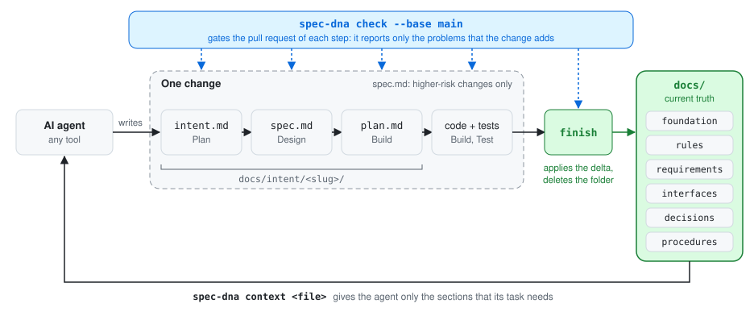

# Concepts

This page explains how spec-dna works and why. It gives the model, not each option. Each section ends with links to the reference pages that give the details. [glossary.md](glossary.md) gives the meaning of each term.

<picture>
  <source media="(prefers-color-scheme: dark)" srcset="assets/how-it-works-dark.svg">
  
</picture>

An agent writes one change. `finish` applies the delta of the change to the current truth and deletes the folder of the change. `check` gates the pull request of each step. `context` gives the agent only the sections that its task needs. A small fix has no folder: it is a pull request only.

## The problem

When AI agents write a large part of the code, the specifications are the main input of each task. Then 4 problems occur:

1. An agent changes a decision that the team accepted. For example, it edits the text of an accepted decision so that the text agrees with its new code. A review can miss this edit.
2. References go stale. A change renames a file or a function, but a document still names the old one.
3. Documents grow. Each task adds text, and nobody removes it. An agent reads whole long files to find one rule, and each task costs more tokens.
4. Proposals and plans stay in the tree after the work. An agent cannot tell them from the current truth.

spec-dna treats the specifications as code. Each document has a type and a stable id. Each requirement has a key and a hash. A check compares each change with its base, as a linter does for code. A change has its own folder, and `finish` deletes the folder when the change is complete.

## Documents and types

The documents are plain Markdown files in git. spec-dna reads their front matter, headings, links, code spans and requirement list items. It needs no database and no service.

Each document has 1 of 15 types. The place of a file gives its type: a file under `rules/` is a `rule`, and `terms.md` is the `terms` document. A `type:` field in the front matter is necessary only where the place gives no type.

| Type | Content | Place in a new project |
| --- | --- | --- |
| `product`, `system`, `terms` | What the product is, how the system works, the terms of the project | `docs/product.md`, `docs/system.md`, `docs/terms.md` |
| `roadmap`, `questions` | Planned work and open questions | `docs/roadmap.md`, `docs/questions.md` |
| `rule` | Project-wide rules with stable ids | `docs/rules/` |
| `requirements` | The behavior and the constraints of one capability | `docs/requirements/<area>/` |
| `interface` | An API, an event or a tool schema | `docs/interfaces/` |
| `decision` | The reason for a choice (MADR) | `docs/decisions/` |
| `procedure` | A guide or a runbook | `docs/procedures/` |
| `incident` | A post-mortem record of one event | `docs/incidents/` |
| `research` | Material that agents read only on request | `docs/research/` |
| `intent`, `spec`, `plan` | The documents of one change | `docs/intent/<slug>/` |

A `status` field gives the lifecycle of a document, for example `draft`, `active` and `retired`. A status moves forward only. After a decision is `accepted`, its text is locked. A new fact goes into an amendment section, or into a new decision that supersedes the old one. Only a live section, such as `Status`, can change without an amendment.

A mature repository keeps its folders. A root in `spec-dna.toml` maps a folder to a type, so no file has to move.

Reference: [types.md](types.md), [config.md](config.md).

## Ids and requirements

The id of a document is its path in its root, without `.md`, for example `requirements/valves/closing`. A requirement is a list item with a bold key and a BCP 14 keyword, such as SHALL or MUST:

```md
- **sensor-timeout**: When a moisture sensor times out, the controller SHALL close the valve of its bed.
```

The id of this requirement is `requirements/valves/closing#sensor-timeout`. Other documents, tests and changes refer to it by this id.

- **Hash.** spec-dna keeps a hash of each requirement and each section: the first 16 hexadecimal digits of SHA-256 over the normalized text. The key is not part of the hash, so a move or a new key keeps the hash. `spec-dna show <requirement id>` prints the hash of a requirement, and `context` prints the hash of each section.
- **Alias.** `spec-dna mv` moves a document or a requirement and writes the old id as an alias. A reference to the old id continues to resolve.
- **Evidence.** A test links itself to a requirement with a comment such as `# covers: requirements/valves/closing#sensor-timeout`. A document can also name its tests in `verified-by`. `show` lists the tests of each requirement.
- **Code citations.** A code span in a document can name a file or a symbol, such as `src/valves.rs` or `close_valve()`. `check` reports a citation that does not resolve after a change.

Reference: [commands.md](commands.md#show) (`show`, `mv`), [config.md](config.md#evidence), [diagnostics.md](diagnostics.md#code-citations).

## Layers and the graph

A layer is a named set of document types. It has a folder, or top files such as `terms.md`. The layers form a graph. An edge `moves-to` means that the text of one layer matures into another layer. For example, an intent moves into requirements and decisions, and an incident moves into a new intent.

The level of a layer is the length of its longest `moves-to` path. Level 0 is the most stable. The layers of level 0 are the stable layers. The current truth of the project, its requirements, rules and interfaces, is in stable layers. This is the default graph:

| Layer | Types | Level | `context` |
| --- | --- | --- | --- |
| `foundation` | `product`, `system`, `terms` | 0 | `always` |
| `rules` | `rule` | 0 | `always` |
| `requirements` | `requirements` | 0 | `always` |
| `interfaces` | `interface` | 0 | `always` |
| `decisions` | `decision` | 0 | `always` |
| `procedures` | `procedure` | 0 | `always` |
| `research` | `research` | 1 | `on-request` |
| `intent` | `intent`, `spec`, `plan` | 1 | `on-request` |
| `incidents` | `incident` | 2 | `on-request` |
| `pending` | `roadmap`, `questions` | 2 | `on-request` |

These rules follow from the graph:

- `context` gives the layers by level, from 0 up.
- A document must not link a document of a less stable layer, unless that layer allows it in `linked-from` (SD901). Thus a stable layer never depends on a proposal.
- A layer can limit its size with `max-docs` and `max-chars` (SD902).
- A layer with `context = "always"` can fill the context with no named target. A top file of `foundation` goes into the context only for its `applies-to` paths.
- The documents of an `on-request` layer go to an agent only when the agent names them.

`init` proposes a small graph of 7 layers for a project with fewer than 30 documents. `spec-dna layer add` adds a layer later, and `spec-dna layer list` shows the layers and their levels.

Reference: [config.md](config.md#the-table-layers), [commands.md](commands.md#layer).

## The gate

`spec-dna check` compares the head with a base and reports only the problems that the change adds. Without `--base`, the base is `HEAD`, so `check` reads the edits that are not committed. In CI, `--base origin/<main branch>` makes the base the merge base with the target branch. The checks of the change lifecycle need the base of the pull request. Without `--base`, they use the merge base with the default branch.

Thus a mature repository can adopt spec-dna before it fixes the old problems. `check --all` shows each problem once. The gate fails only on a new error.

`check` finds, for example, these problems:

- A link, an id or an anchor that does not resolve, and an id that a change removed with no alias.
- An edit of the locked text of an accepted decision (SD405).
- A document over its budget, or with no required section.
- A code citation that a change made stale.
- A link from a stable layer to a less stable layer (SD901).
- A change of a requirement, a rule or an interface with no intent folder (SD921).
- An artifact of a change with no approval of the stage before it (SD910).

A profile (`lite`, `standard` or `strict`) gives the default severity of each code, and `[rules]` changes the severity of one code. `spec-dna.toml` pins the version of spec-dna, so each person and each CI job uses the same rules.

Reference: [commands.md](commands.md#check), [diagnostics.md](diagnostics.md), [profiles.md](profiles.md), [config.md](config.md#the-pin-comes-first).

## The change lifecycle

A change is a folder `docs/intent/<slug>/`. It holds these documents:

- `intent.md`: what the originator wants and why.
- `spec.md`: the delta of the requirements.
- `plan.md`: the files, the order, the risks and the proof.

The folder stays on the default branch while the work continues. When the work is complete, `finish` applies the delta to the requirements and deletes the folder. Git keeps the history, and `spec-dna log` lists the finished changes.

A change has a class: `small-fix` (a pull request only), `routine` (an intent and a plan) or `higher-risk` (an intent, a spec and a plan). [The change guide](guides/change.md#choose-the-class) gives the documents, the approver and the minimum class of each change.

To approve a document is to set its status (`accepted` or `approved`) in a commit that a pull request merges. spec-dna reads the approval from the base tree, and the branch protection of the repository decides who can merge. Each document of a change needs the approval of the document before it (SD910). `[change] gate` makes this rule an error (`block`), a warning (`warn`) or nothing (`off`).

A change has no stage field. spec-dna derives the stage (Plan, Design, Build, Test, Deploy or Maintain) from the files, their statuses and git. `spec-dna status` shows each change and its stage. `spec-dna next <slug>` prints the checklist to the next gate. `spec-dna stats --sdlc` prints the indicators of each stage that git can give.

`[change] policy` sets the classes that a project uses: `three-class`, `two-class` or `none`. A new project has `three-class`. An upgraded project has `none`: it has the layers and their checks, but no change process.

Reference: [guides/change.md](guides/change.md), [config.md](config.md#the-table-change), [commands.md](commands.md).

## Context

`spec-dna context <file>` gives an agent the sections that apply to the files that it will change. Examples are the requirements that cite the file, the rules whose `applies-to` matches the path, and the summaries of the linked decisions. `context` gives the layers by level, so it gives the stable layers first.

The unit is a section, with its id and its hash. Thus an agent can cite what it read. A spec names the hash of each requirement that it changes, and `finish` stops if that text changed after the author read it (SD914). A budget limits the size of the output. `context` lists a section that does not fit with its id, hash and size. It counts the documents of `on-request` layers in one line and does not give them.

`spec-dna show <id>` gives one whole document. It also works for a document of an `on-request` layer.

Reference: [commands.md](commands.md#context).

## Agents and adapters

spec-dna is a command-line tool, so each agent that can run a shell command can use it. The agent follows 2 steps: it runs `spec-dna context <file>` before an edit, and `spec-dna check` before the work is complete. `spec-dna init` writes these steps into the instruction file of the agent. Codex, Cursor and many other agents read `AGENTS.md`, and Claude Code reads `CLAUDE.md`.

An adapter adds more for one agent. The Claude Code adapter adds these parts:

- A harness at the level `lean` or `full`: roles with their models, such as an orchestrator, an advisor, a `verifier` and a researcher.
- Skills for the stages Plan, Design, Build and Deploy of a change, and `REVIEW.md` for the review of a pull request.
- Hooks that measure the context, limit the number of agents that a workflow starts, and protect the tests during a fix.
- Evals: `spec-dna eval run` gives tasks with checks to headless Claude Code, under a cost limit, and reports the pass rate. A new incident needs a new eval (SD918).

`check` reports a generated file that a person edited (SD501), so the files of an adapter stay in agreement with the configuration.

Reference: [agents.md](agents.md), [harness.md](harness.md), [evals.md](evals.md).

## What spec-dna does not do

- It uses no network and no language model. The one exception is `eval run`, which starts an agent.
- It does not write the specifications. An agent or a person writes them, and spec-dna checks them.
- It does not know who approved a change. The branch protection of the repository decides who can merge.
- It does not read pull request data, CI logs or an issue tracker. `stats --sdlc` marks the indicators that need them as `n/a`.
- It never changes a requirement to agree with the code. `finish` is the only command that deletes documents. It deletes only the folder of a change.
